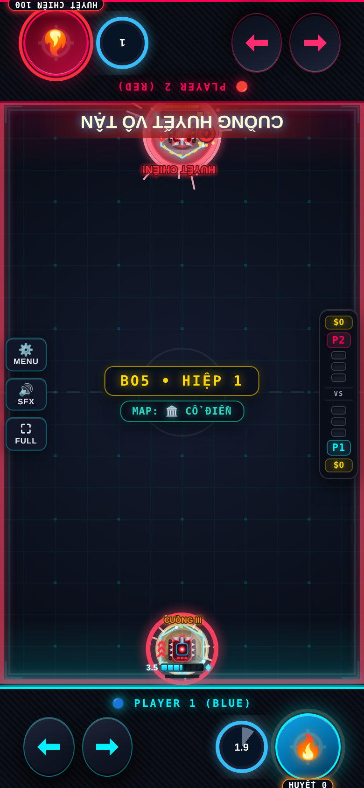

# Cuồng Chiến Binh — Evo 3/4

Issue #2; danh sách theo comment cập nhật của chủ repo.

## Evo 3: Tự Rạch ($110)

Nhấp đúp (hồi 1s): mất 0.5 HP, không dưới 1; +12 Huyết Chiến và chuẩn bị Huyết Đạn.

## Evo 4: Gào Thét ($170)

Hưởng buff mốc ≤25% trong 4s (CD 18s). Nộ từ dame nhận x1.5 và dame gây. CUỒNG HUYẾT VÔ TẬN cần HP≤50%: vào Huyết Chiến, giữ thanh 100 bốn giây, mỗi hit hồi 0.1 HP; Huyết Đạn kết liễu ≤20%.

## Full Evo

| Cặp | Hiệu ứng |
|---|---|
| 1+2 | Full Evo nguyên bản. |
| 1+3 | Tự Rạch còn +10% tốc bắn trong 3s. |
| 2+4 | Ultimate dựng Đấu Trường Huyết Địa bản mạnh. |
| 1+2+3+4 | Gào Thét không CD trong Ultimate. |

Các cặp chưa có hiệu ứng riêng nhận thưởng chung của framework. Cặp được chốt theo hai Evo mua đầu; chỉ 1234 được nâng khi có đủ bốn Evo và Con Đường Tiến Hóa.

## Cân bằng và điều chỉnh

Tự Rạch không hạ HP dưới 1 và hồi 1s. Ultimate cần HP≤50%, giữ thanh Huyết Chiến 4s; kết liễu chỉ cho Huyết Đạn khi địch≤20%.

## Kiểm chứng

Đã thử P1 và P2: cơ chế Evo 3, Skill, điều kiện Tuyệt Kỹ, tổ hợp riêng, mô phỏng vật lý và round-trip NetState. Kiểm tra thêm host/guest bốn hiệp/body. Số liệu trước/sau và giới hạn phép đo nằm trong [báo cáo chung](../EVO_PILOT_RESULTS.md).

