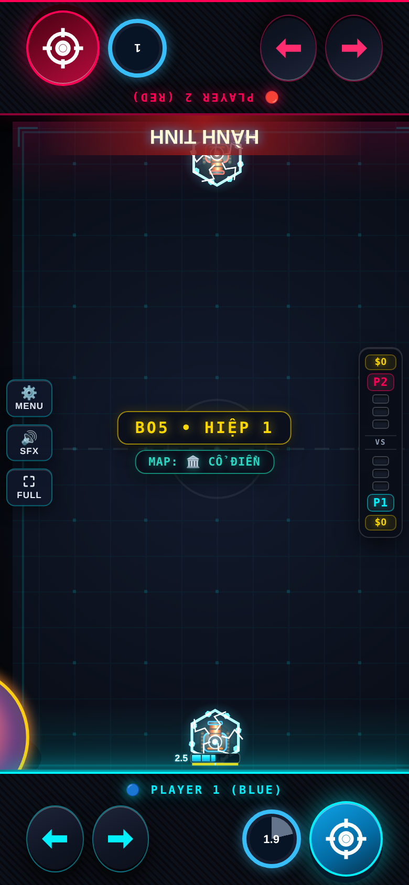

# Đạn Lớn — Evo 3/4

Issue #2; danh sách theo comment cập nhật của chủ repo.

## Evo 3: Ôm Bóng ($140)

Giữ Bắn: ôm cầu trước mũi xe để nuốt đạn địch, cầu lớn dần. Nhả Bắn: sút cầu đi; tốn 1 đạn.

## Evo 4: Cú Sút Bẻ Lái ($150)

Mở nút Skill: bẻ mọi cầu đang bay về phía địch, thêm 1 lần nảy (CD 9s). Đầy Nộ: HÀNH TINH lăn qua làn địch, ăn đạn và nổ mảnh khi chạm biên. Full Evo 3+4: sút cầu đã nuốt đạn giảm CD Skill (tối đa 1.5s).

## Full Evo

| Cặp | Hiệu ứng |
|---|---|
| 1+2 | Xuyên thấu sau lần nảy thứ 2 và nổ mảnh 360°. |
| 1+3 | Cầu đang ôm lớn gấp rưỡi. |
| 2+3 | Mỗi đạn nuốt cho cầu thêm 1 lần nảy. |
| 1+2+3+4 | Hành Tinh nảy 3 lần giữa hai biên. |
| 3+4 | Sút cầu đã nuốt đạn giảm 0.5s CD Skill mỗi đạn, tối đa 1.5s/lần sút. |

Các cặp chưa có hiệu ứng riêng nhận thưởng chung của framework. Cặp được chốt theo hai Evo mua đầu; chỉ 1234 được nâng khi có đủ bốn Evo và Con Đường Tiến Hóa.

## Cân bằng và điều chỉnh

Giữ body mẫu của #1, bổ sung Full Evo 3+4: sút cầu đã nuốt đạn giảm CD Skill 0.5s/đạn, tối đa 1.5s. Bot giữ/nhả cầu theo nhịp thay vì giữ vô hạn.

Hệ số lối ghép áp dụng khi có cặp Evo, kể cả trước khi mua thẻ Full Evo; thẻ thêm hiệu ứng lên cùng nền chỉ số. 1234 dùng hệ số 1+2 nếu không khai báo riêng. Các hệ số khác 1 được hiện trên thẻ Full Evo:

| Cặp | Max HP | Dame | Sát thương nhận |
|---|---:|---:|---:|
| 1+2 | ×1 | ×0.55 | ×1.2 |
| 2+3 | ×1 | ×0.95 | ×1 |
| 2+4 | ×1 | ×0.4 | ×1.5 |

## Kiểm chứng

Đã thử P1 và P2: cơ chế Evo 3, Skill, điều kiện Tuyệt Kỹ, tổ hợp riêng, mô phỏng vật lý và round-trip NetState. Kiểm tra thêm host/guest bốn hiệp/body. Số liệu trước/sau và giới hạn phép đo nằm trong [báo cáo chung](../EVO_PILOT_RESULTS.md).

