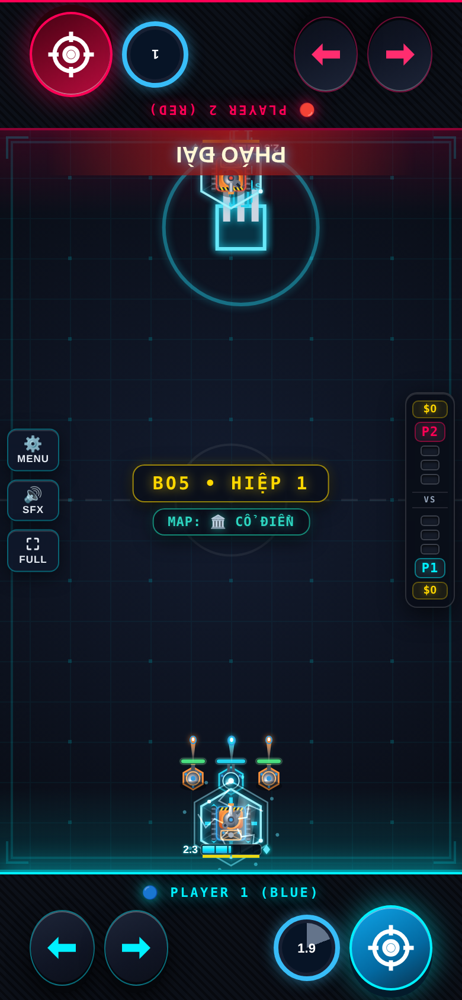

# Kỹ Sư — Evo 3/4

Issue #2; danh sách theo comment cập nhật của chủ repo.

## Evo 3: Ụ Gắn Nóc ($150)

Nhấp đúp để gắn/thả ụ thông minh gần nhất lên nóc; bắn khi di chuyển ở 60% tốc độ; xe mang ụ giảm 1.5 Max HP.

## Evo 4: Đồng Loạt Khai Hỏa ($160)

Mọi ụ bắn ngay loạt x2 dame và hồi 30% HP (CD 10s). Nộ: +6/Phụ Tùng, +1/s/ụ. PHÁO ĐÀI cần ≥3 ụ: hợp thể 6s bắn tia cảnh báo mỗi 0.6s rồi tách lại đầy máu.

## Full Evo

| Cặp | Hiệu ứng |
|---|---|
| 1+2 | Full Evo nguyên bản. |
| 1+3 | Ụ gắn nóc bắn đủ 100% tốc độ. |
| 2+4 | Siêu Pháo có vòng LAN hồi máu chủ. |
| 1+2+3+4 | Tia Siêu Pháo xuyên tường. |

Các cặp chưa có hiệu ứng riêng nhận thưởng chung của framework. Cặp được chốt theo hai Evo mua đầu; chỉ 1234 được nâng khi có đủ bốn Evo và Con Đường Tiến Hóa.

## Cân bằng và điều chỉnh

Tối đa 3 ụ thường + 3 ụ thông minh mỗi chủ; ụ cũ nhất cùng loại bị thay. Pháo Đài gộp 3 ụ trong 6s, bắn từ vị trí pháo, rồi trả 3 ụ đầy HP. Gắn nóc giảm 1.5 Max HP từ lúc mua Evo 3.

Hệ số lối ghép áp dụng khi có cặp Evo, kể cả trước khi mua thẻ Full Evo; thẻ thêm hiệu ứng lên cùng nền chỉ số. 1234 dùng hệ số 1+2 nếu không khai báo riêng. Các hệ số khác 1 được hiện trên thẻ Full Evo:

| Cặp | Max HP | Dame | Sát thương nhận |
|---|---:|---:|---:|
| 1+2 | ×1 | ×0.55 | ×1.5 |
| 1+4 | ×1 | ×0.5 | ×1.4 |
| 2+4 | ×1 | ×0.85 | ×1 |

## Kiểm chứng

Đã thử P1 và P2: cơ chế Evo 3, Skill, điều kiện Tuyệt Kỹ, tổ hợp riêng, mô phỏng vật lý và round-trip NetState. Kiểm tra thêm host/guest bốn hiệp/body. Số liệu trước/sau và giới hạn phép đo nằm trong [báo cáo chung](../EVO_PILOT_RESULTS.md).

