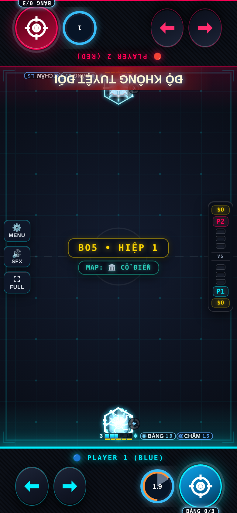

# Pháo Băng — Evo 3/4

Issue #2; danh sách theo comment cập nhật của chủ repo.

## Evo 3: Hơi Thở Băng Giá ($100)

Giữ 1s, nhả bắn mũi băng xuyên và tạo làn băng trượt 4s.

## Evo 4: Đông Cứng Tức Thì ($140)

Đóng băng địch đang chậm 0.8s (CD 12s). Nộ: +10/lần chậm mới, +20/Bão Tuyết. Tuyệt Kỹ ĐỘ KHÔNG TUYỆT ĐỐI: băng 2s rồi vỡ (tối đa 3 dame); kết liễu địch đóng băng ≤20%.

## Full Evo

| Cặp | Hiệu ứng |
|---|---|
| 1+2 | Full Evo nguyên bản. |
| 1+3 | Bão Tuyết nở dọc làn băng. |
| 2+4 | Hàn Băng tăng 50% dame lên địch đóng băng. |
| 1+2+3+4 | Ultimate đóng băng mọi đạn địch đang bay. |

Các cặp chưa có hiệu ứng riêng nhận thưởng chung của framework. Cặp được chốt theo hai Evo mua đầu; chỉ 1234 được nâng khi có đủ bốn Evo và Con Đường Tiến Hóa.

## Cân bằng và điều chỉnh

Mũi băng giữ cờ isIce/createIceZone để tương tác đúng Evo 1/2. Juggernaut nhận chậm thay đóng băng. Làn trượt áp dụng theo chiều di chuyển ngang của địch.

Hệ số lối ghép áp dụng khi có cặp Evo, kể cả trước khi mua thẻ Full Evo; thẻ thêm hiệu ứng lên cùng nền chỉ số. 1234 dùng hệ số 1+2 nếu không khai báo riêng. Các hệ số khác 1 được hiện trên thẻ Full Evo:

| Cặp | Max HP | Dame | Sát thương nhận |
|---|---:|---:|---:|
| 1+2 | ×1 | ×0.7 | ×1.6 |
| 1+3 | ×1 | ×0.9 | ×1 |
| 2+3 | ×1 | ×0.55 | ×1.8 |

## Kiểm chứng

Đã thử P1 và P2: cơ chế Evo 3, Skill, điều kiện Tuyệt Kỹ, tổ hợp riêng, mô phỏng vật lý và round-trip NetState. Kiểm tra thêm host/guest bốn hiệp/body. Số liệu trước/sau và giới hạn phép đo nằm trong [báo cáo chung](../EVO_PILOT_RESULTS.md).

