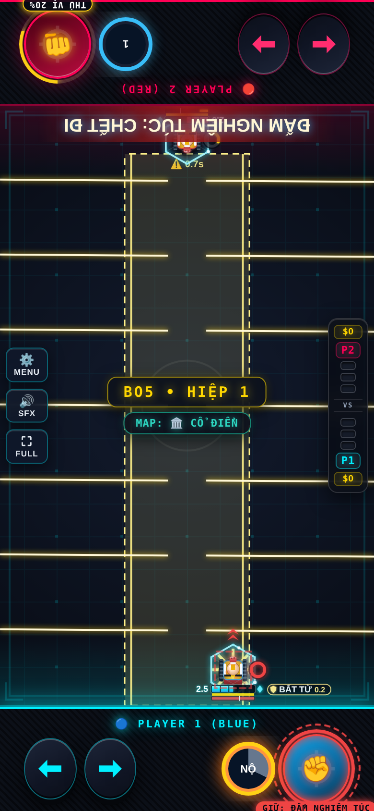

# Nhất Quyền / Một Đấm — Evo 3/4

Issue #2; danh sách theo comment cập nhật của chủ repo.

## Evo 3: Chạy Bộ Mỗi Ngày ($110)

Di chuyển liên tục 3s tăng 5% Thú Vị; đổi lại giảm 2 Max HP.

## Evo 4: Né Bình Thường ($150)

Bước ngang né 0.25s, +10% Thú Vị (CD 6s). +1 Nộ/1% Thú Vị tăng. ĐẤM NGHIÊM TÚC: CHẾT ĐI cần Thú Vị 100%, cảnh báo 0.8s rồi tia rộng 1/3 sân xuyên tường; kết liễu ≤50%, còn lại 3 dame.

## Full Evo

| Cặp | Hiệu ứng |
|---|---|
| 1+2 | Full Evo nguyên bản. |
| 1+3 | Chạy bộ tăng 8% Thú Vị. |
| 2+4 | Bật ngang trước khi khóa cảnh báo Ultimate. |
| 1+2+3+4 | Điều kiện Ultimate giảm còn 80% Thú Vị. |

Các cặp chưa có hiệu ứng riêng nhận thưởng chung của framework. Cặp được chốt theo hai Evo mua đầu; chỉ 1234 được nâng khi có đủ bốn Evo và Con Đường Tiến Hóa.

## Cân bằng và điều chỉnh

Tích Thú Vị chỉ khi thực sự di chuyển; Evo 3 giảm 2 Max HP. Ultimate cần 100 Thú Vị (80 ở 1234), có cảnh báo 0.8s; chỉ kết liễu địch≤50%.

Hệ số lối ghép áp dụng khi có cặp Evo, kể cả trước khi mua thẻ Full Evo; thẻ thêm hiệu ứng lên cùng nền chỉ số. 1234 dùng hệ số 1+2 nếu không khai báo riêng. Các hệ số khác 1 được hiện trên thẻ Full Evo:

| Cặp | Max HP | Dame | Sát thương nhận |
|---|---:|---:|---:|
| 1+2 | ×0.75 | ×0.85 | ×1 |
| 1+3 | ×0.9 | ×0.75 | ×1 |
| 1+4 | ×0.8 | ×0.5 | ×1 |

## Kiểm chứng

Đã thử P1 và P2: cơ chế Evo 3, Skill, điều kiện Tuyệt Kỹ, tổ hợp riêng, mô phỏng vật lý và round-trip NetState. Kiểm tra thêm host/guest bốn hiệp/body. Số liệu trước/sau và giới hạn phép đo nằm trong [báo cáo chung](../EVO_PILOT_RESULTS.md).

