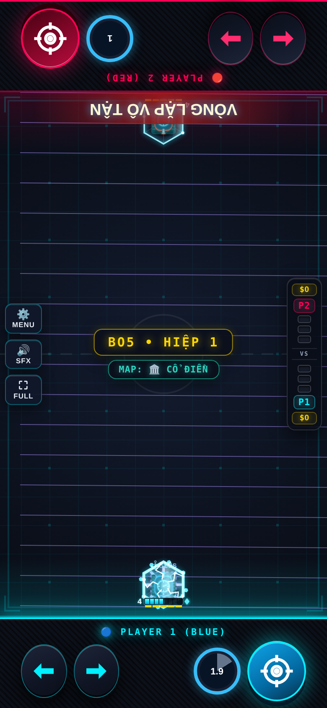

# Paradox — Evo 3/4

Issue #2; danh sách theo comment cập nhật của chủ repo.

## Evo 3: Dấu Nhân Quả ($160)

Dư Âm trúng khắc tối đa 4 Dấu; lần tua/về neo kế tiếp nổ 0.3 dame mỗi Dấu.

## Evo 4: Quy Neo ($200)

Về Neo ngay, chưa có thì đặt Neo (CD 12s). +10 Nộ/lần tua, +4/Dư Âm trúng. VÒNG LẶP VÔ TẬN kéo địch về vị trí 5s trước, tái hiện loạt đạn 5s qua với trần ngân sách dame.

## Full Evo

| Cặp | Hiệu ứng |
|---|---|
| 1+2 | Full Evo nguyên bản. |
| 1+3 | Dấu Nhân Quả cũng tích Ấn Thời Gian. |
| 2+4 | Vòng Lặp tái hiện thêm bóng 3s. |
| 1+2+3+4 | Mọi Vết Nứt khai hỏa theo Vòng Lặp. |

Các cặp chưa có hiệu ứng riêng nhận thưởng chung của framework. Cặp được chốt theo hai Evo mua đầu; chỉ 1234 được nâng khi có đủ bốn Evo và Con Đường Tiến Hóa.

## Cân bằng và điều chỉnh

Vòng lặp ghi lịch sử đạn bằng dữ liệu thuần, phát lại tối đa ngân sách 55% Max HP địch. Ấn được giới hạn 4 và tiêu khi quay Neo.

Hệ số lối ghép áp dụng khi có cặp Evo, kể cả trước khi mua thẻ Full Evo; thẻ thêm hiệu ứng lên cùng nền chỉ số. 1234 dùng hệ số 1+2 nếu không khai báo riêng. Các hệ số khác 1 được hiện trên thẻ Full Evo:

| Cặp | Max HP | Dame | Sát thương nhận |
|---|---:|---:|---:|
| 1+2 | ×1 | ×0.75 | ×1.25 |
| 1+4 | ×1 | ×0.55 | ×1.5 |

## Kiểm chứng

Đã thử P1 và P2: cơ chế Evo 3, Skill, điều kiện Tuyệt Kỹ, tổ hợp riêng, mô phỏng vật lý và round-trip NetState. Kiểm tra thêm host/guest bốn hiệp/body. Số liệu trước/sau và giới hạn phép đo nằm trong [báo cáo chung](../EVO_PILOT_RESULTS.md).

