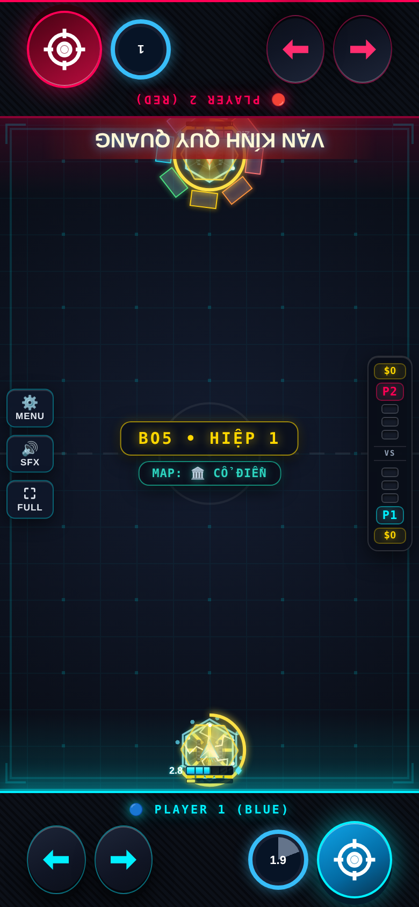

# Phản Chiếu — Evo 3/4

Issue #2; danh sách theo comment cập nhật của chủ repo.

## Evo 3: Khúc Xạ Kép ($120)

Tia Khúc Xạ nảy thêm một lần; lần nảy đầu tách đôi (mỗi tia 50% dame).

## Evo 4: Lăng Kính Tức Thì ($170)

Bật Cửa Sổ Vàng 0.35s, không tiêu CD Mở Kính (CD Skill 10s). +10 Nộ/đòn phản, +20/phản vàng. VẠN KÍNH QUY QUANG: 4s phản x1.5, cuối chiêu hội tụ tia cảnh báo 0.4s; kết liễu ≤25%.

## Full Evo

| Cặp | Hiệu ứng |
|---|---|
| 1+2 | Full Evo nguyên bản. |
| 1+3 | Hai tia tách đôi gây 70% dame mỗi tia. |
| 2+4 | Kết thúc Ultimate bắn thêm 5 mảnh kính. |
| 1+2+3+4 | Lăng Kính Tức Thì kéo dài 0.5s. |

Các cặp chưa có hiệu ứng riêng nhận thưởng chung của framework. Cặp được chốt theo hai Evo mua đầu; chỉ 1234 được nâng khi có đủ bốn Evo và Con Đường Tiến Hóa.

## Cân bằng và điều chỉnh

Kỹ năng không tiêu CD Mở Kính cũ. Chia đôi xảy ra một lần; tia được nảy thêm đúng một lần. Tia hội tụ có cảnh báo 0.4s.

Hệ số lối ghép áp dụng khi có cặp Evo, kể cả trước khi mua thẻ Full Evo; thẻ thêm hiệu ứng lên cùng nền chỉ số. 1234 dùng hệ số 1+2 nếu không khai báo riêng. Các hệ số khác 1 được hiện trên thẻ Full Evo:

| Cặp | Max HP | Dame | Sát thương nhận |
|---|---:|---:|---:|
| 2+3 | ×0.8 | ×1 | ×1 |

## Kiểm chứng

Đã thử P1 và P2: cơ chế Evo 3, Skill, điều kiện Tuyệt Kỹ, tổ hợp riêng, mô phỏng vật lý và round-trip NetState. Kiểm tra thêm host/guest bốn hiệp/body. Số liệu trước/sau và giới hạn phép đo nằm trong [báo cáo chung](../EVO_PILOT_RESULTS.md).

