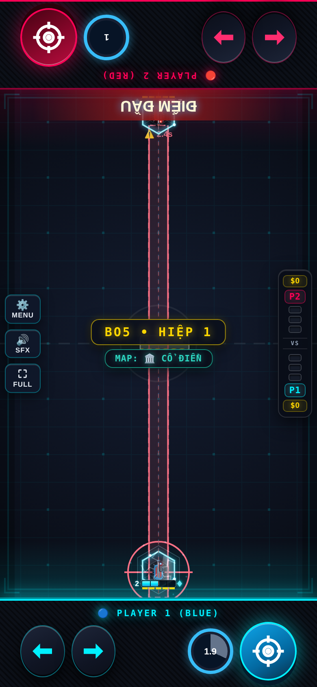

# Sniper — Evo 3/4

Issue #2; danh sách theo comment cập nhật của chủ repo.

## Evo 3: Lỗ Châu Mai ($130)

Đạn qua tường mình +40% dame, +30% tốc; chỉ nhận buff một lần.

## Evo 4: Dời Tường ($150)

Dời tường gần nhất về trục xe (CD 6s). +12 Nộ/phát trúng, +6/đòn tường chặn. ĐIỂM ĐẦU cần trúng ≥2 lần: khóa ngắm 2.5s rồi tia xuyên tường; kết liễu khi ≤40%.

## Full Evo

| Cặp | Hiệu ứng |
|---|---|
| 1+2 | Full Evo nguyên bản. |
| 1+3 | Lỗ Châu Mai tăng 60% dame. |
| 2+3 | Đạn qua tường thành raycast có cảnh báo. |
| 1+2+3+4 | Điểm Đầu bắn hai phát, chia cùng ngân sách dame. |

Các cặp chưa có hiệu ứng riêng nhận thưởng chung của framework. Cặp được chốt theo hai Evo mua đầu; chỉ 1234 được nâng khi có đủ bốn Evo và Con Đường Tiến Hóa.

## Cân bằng và điều chỉnh

Điểm Đầu khóa trục địch tại lúc tung và cảnh báo cố định 2.5s; bản thí điểm không thêm thao tác nhả sớm. Tia 1234 chia cùng ngân sách dame. Buff Lỗ Châu Mai chỉ áp một lần mỗi đạn.

Hệ số lối ghép áp dụng khi có cặp Evo, kể cả trước khi mua thẻ Full Evo; thẻ thêm hiệu ứng lên cùng nền chỉ số. 1234 dùng hệ số 1+2 nếu không khai báo riêng. Các hệ số khác 1 được hiện trên thẻ Full Evo:

| Cặp | Max HP | Dame | Sát thương nhận |
|---|---:|---:|---:|
| 1+2 | ×1 | ×0.95 | ×1 |
| 2+3 | ×1 | ×0.3 | ×2 |
| 2+4 | ×1 | ×0.7 | ×1.25 |

## Kiểm chứng

Đã thử P1 và P2: cơ chế Evo 3, Skill, điều kiện Tuyệt Kỹ, tổ hợp riêng, mô phỏng vật lý và round-trip NetState. Kiểm tra thêm host/guest bốn hiệp/body. Số liệu trước/sau và giới hạn phép đo nằm trong [báo cáo chung](../EVO_PILOT_RESULTS.md).

