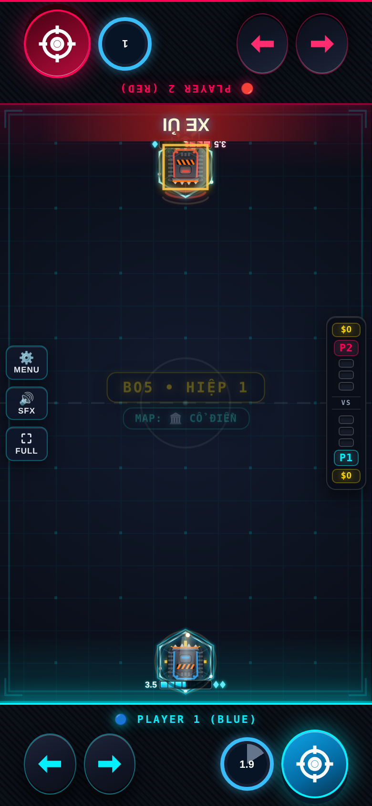

# Xe TANK — Evo 3/4

Issue #2; danh sách theo comment cập nhật của chủ repo.

## Evo 3: Cần Lái Thủy Lực ($130)

Giữ Bắn để húc tối đa 1.5s, bẻ lái bằng trái/phải; nhả để trở về làn. Đổi lại −3.5 Max HP.

## Evo 4: Xả Khiên Dự Phòng ($150)

Skill: +1 khiên và đẩy đạn quanh xe (CD 12s). Nộ từ húc trúng/nhận dame khi lao. Tuyệt Kỹ XE ỦI: lao xuyên sân, ép địch; kết liễu khi địch ≤20%.

## Full Evo

| Cặp | Hiệu ứng |
|---|---|
| 1+2 | Full Evo nguyên bản. |
| 1+3 | Thủy Lực không mất tốc khi bẻ lái. |
| 2+4 | Khiên Skill nổ kèm vùng băng. |
| 1+2+3+4 | Xe Ủi để lại hai vệt băng. |

Các cặp chưa có hiệu ứng riêng nhận thưởng chung của framework. Cặp được chốt theo hai Evo mua đầu; chỉ 1234 được nâng khi có đủ bốn Evo và Con Đường Tiến Hóa.

## Cân bằng và điều chỉnh

Húc thường giữ vòng trạng thái cũ. Cặp 1+2 nghỉ 5s; khiên nội tại giới hạn 1; nổ theo 0.5×dame, giáp húc nhận 65% sát thương (Evo 1: 40%). Full 1+2 cộng 6 HP trước hệ số lối ghép, hồi khiên 4s. Skill vẫn có thể thêm khiên vượt giới hạn nội tại.

Hệ số lối ghép áp dụng khi có cặp Evo, kể cả trước khi mua thẻ Full Evo; thẻ thêm hiệu ứng lên cùng nền chỉ số. 1234 dùng hệ số 1+2 nếu không khai báo riêng. Các hệ số khác 1 được hiện trên thẻ Full Evo:

| Cặp | Max HP | Dame | Sát thương nhận |
|---|---:|---:|---:|
| 1+2 | ×0.4 | ×0.4 | ×3 |
| 1+3 | ×1 | ×0.5 | ×3 |
| 1+4 | ×0.6 | ×0.3 | ×3 |
| 2+3 | ×1 | ×0.8 | ×1.3 |
| 2+4 | ×1 | ×0.65 | ×1.4 |

## Kiểm chứng

Đã thử P1 và P2: cơ chế Evo 3, Skill, điều kiện Tuyệt Kỹ, tổ hợp riêng, mô phỏng vật lý và round-trip NetState. Kiểm tra thêm host/guest bốn hiệp/body. Số liệu trước/sau và giới hạn phép đo nằm trong [báo cáo chung](../EVO_PILOT_RESULTS.md).

